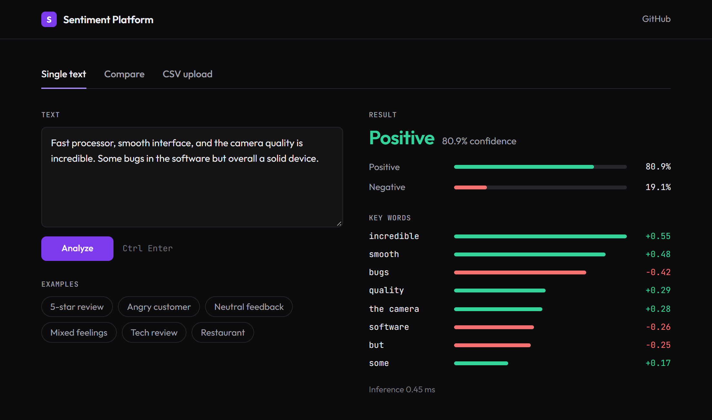

# Sentiment Analysis Platform

Paste in some text and get a positive or negative prediction, along with the words that pushed the model each way. The model is TF-IDF plus logistic regression trained on 1.6 million tweets (Sentiment140). It is served by a FastAPI backend, and a React dashboard handles single texts, side-by-side comparisons and CSV uploads.

Live demo: [sentiment-dashboard-nr3s.onrender.com](https://sentiment-dashboard-nr3s.onrender.com). It runs on a free Render instance, so the first request can take up to a minute while the API wakes up.



## How it works

1. **Cleaning.** Text is lowercased, and links, @mentions, #hashtags, numbers and punctuation are stripped. The same `clean_text` runs in training and in the API, and a test checks that the two copies match.
2. **Features.** A TF-IDF vectorizer scores the text against a vocabulary of 50,000 words and two-word phrases.
3. **Classifier.** Logistic regression turns those scores into a probability of positive vs. negative.

Each key word's score is its TF-IDF value times the model's coefficient for that term. In other words, it is how far that term moved the log-odds. Two-word phrases matter. In "Not bad at all, I would buy it again", the word `bad` pushes toward negative (−1.24), but the phrase `not bad` pushes harder toward positive (+3.24). The result is 88% positive.

## How well it does

Trained on 1,280,000 tweets and tested on the other 320,000 (a stratified 80/20 split):

|          | Precision | Recall | F1    |
| -------- | --------- | ------ | ----- |
| Negative | 0.825     | 0.806  | 0.816 |
| Positive | 0.811     | 0.829  | 0.820 |

Overall accuracy is 81.8%. The confusion matrix and the rest of the metrics are in [`model/metadata.json`](model/metadata.json). A prediction takes under a millisecond.

## Limits

- **Two classes only.** Sentiment140's training set has no neutral tweets, so neutral text still gets a confident guess. For example, "The product is okay. It does what it says but nothing special." comes out 83% negative.
- **Bag of words.** Apart from two-word phrases, word order is ignored. Sarcasm and negation that isn't right next to the word ("not at all what I'd call good") get missed.
- **Noisy, dated labels.** The tweets are from 2009 and were labeled automatically by their emoticons, not by people. Topic words pick up sentiment along the way: `battery` leans negative because tweets about batteries are mostly complaints.
- **English letters only.** Emoji, numbers and non-Latin scripts are removed during cleaning. Text made only of those can't be scored, and the API returns 400.
- **Not production hardened.** There's no auth or rate limiting. `/stats` keeps only in-memory counts.

## Running it

The trained model (2.3 MB) is committed, so no training is needed.

### With Docker

```bash
docker compose up --build
```

The dashboard is at http://localhost:3000 and the API docs at http://localhost:8000/docs.

### Without Docker

Needs Python 3.11+ and Node 20.19+ or 22.12+.

```bash
cd backend
python -m venv .venv
source .venv/bin/activate    # Windows: .venv\Scripts\activate
pip install -r requirements.txt
uvicorn main:app --reload
```

In a second terminal:

```bash
cd frontend
npm ci
npm run dev
```

Open http://localhost:3000. The dev server forwards `/api` to the backend on port 8000. The optional settings are listed in `backend/.env.example` and `frontend/.env.example`.

### Tests

```bash
cd backend && pip install -r requirements-dev.txt && pytest
cd frontend && npm test
```

GitHub Actions runs both suites, builds the frontend, and starts the Docker setup to check that the app can reach the API through nginx.

## API

| Method | Path             | Body / notes                                                |
| ------ | ---------------- | ----------------------------------------------------------- |
| POST   | `/predict`       | `{"text": "..."}`, up to 5,000 characters                   |
| POST   | `/predict/batch` | `{"texts": [...]}`, up to 50; unusable ones go in `skipped` |
| POST   | `/compare`       | `{"text_a": "...", "text_b": "..."}`, plus the difference   |
| GET    | `/model`         | Labels, vocabulary size and test-set metrics                |
| GET    | `/stats`         | Prediction counts since the API started                     |
| GET    | `/health`        | Health check                                                |

```bash
curl -X POST http://localhost:8000/predict \
  -H "Content-Type: application/json" \
  -d '{"text": "Not bad at all, I would buy it again"}'
```

```json
{
  "prediction": "positive",
  "confidence": 0.8806,
  "probabilities": { "negative": 0.1194, "positive": 0.8806 },
  "key_words": [
    { "word": "not bad", "score": 3.2379, "type": "positive" },
    { "word": "bad", "score": 1.2422, "type": "negative" }
  ],
  "...": "..."
}
```

## Retraining

Download `training.1600000.processed.noemoticon.csv` from [Sentiment140 on Kaggle](https://www.kaggle.com/datasets/kazanova/sentiment140), then run:

```bash
pip install -r model/requirements.txt
python model/train.py --data path/to/training.1600000.processed.noemoticon.csv
```

This overwrites `model/sentiment_model.pkl`, `model/tfidf_vectorizer.pkl` and `model/metadata.json`. The API loads whatever is in `model/` when it starts. `python model/train.py --demo` trains a toy three-class model on 100 built-in sentences, which is handy for checking the pipeline. Run `git checkout model/` afterwards to get the real model back.

## License

MIT
